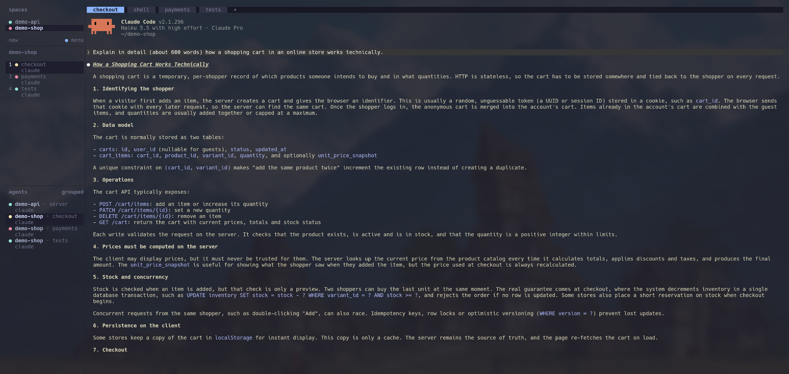
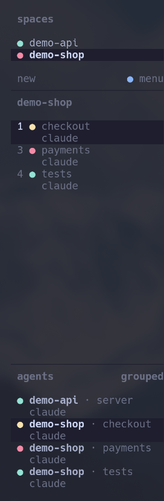

# herdr — current space fork

An unofficial fork of [herdr](https://github.com/herdrdev/herdr), the terminal workspace manager for AI coding agents, with one addition: **a sidebar section that shows only the agents of the space you are in.**

> Not affiliated with or endorsed by the herdr maintainers. For the original project, docs and releases, go to [herdrdev/herdr](https://github.com/herdrdev/herdr).



## Why

I work on several projects in parallel, one herdr space each, with a few coding agents per project. herdr's agents list shows every agent from every space. That is great for spotting which project needs me, but when I switch to a space I also want to see *its* agents at a glance, and which number to press to reach them.

herdr used to have a per-workspace filter for the agents list (`ui.agent_panel_scope = "current"`), but it was removed in 0.8.2 and replaced the full list anyway. I wanted both at once.

## What this fork changes

The expanded sidebar now has three sections instead of two: spaces, the **current space**, and all agents.



- **Current space section** — headed by the current space's name, lists only its agents.
- **Tab numbers** — each row starts with the tab's position, the digit for `prefix+1..9`. Plain shell tabs are skipped, so gaps are fine: in the screenshot tab 2 is a plain shell.
- **Stable order** — always tab order, never re-sorted by status, so the numbers don't jump.
- **Fixed height** — one third of the sidebar, so switching spaces never moves the sections below. When a space has more agents than fit, the last row shows `+N more`, the mouse wheel scrolls, and focusing a hidden agent (e.g. with `prefix+9`) scrolls it into view.
- **Compact spaces** — the spaces section shrinks to its rows (up to half the sidebar), giving the agent sections the room.
- **Click to focus** — like the agents list.

<br clear="right" />

Everything else is upstream herdr: keybindings, the collapsed sidebar, mobile view and the server are untouched. The change is client-only.

## Configuration

On by default. To get upstream's two-section sidebar back:

```toml
# ~/.config/herdr/config.toml
[ui.sidebar.current_space]
enabled = false
```

## Install

### Prebuilt binary (Linux x86_64)

Download `herdr-linux-x86_64` from the [latest release](https://github.com/Malugeli/herdr/releases/latest). It needs glibc 2.39 or newer (e.g. Ubuntu 24.04+, Fedora 40+, current Arch).

```bash
curl -L -o herdr https://github.com/Malugeli/herdr/releases/latest/download/herdr-linux-x86_64
chmod +x herdr
mv herdr ~/.local/bin/herdr
```

### From source

Needs Rust and [Zig 0.16.0](https://ziglang.org/download/):

```bash
git clone https://github.com/Malugeli/herdr.git
cd herdr
ZIG=/path/to/zig-0.16.0/zig cargo build --release --locked
cp target/release/herdr ~/.local/bin/herdr
```

### Switching from upstream herdr

The running server stays compatible: detach (`prefix+q`) and run `herdr` again to get the new sidebar. Don't run `herdr update` afterwards — it replaces the binary with the official release.

## Status

Based on herdr 0.9.3. Tested on Linux only. I sync with upstream when I need a newer feature.

The implementation lives mostly in `src/client/shell/agent_sidebar.rs` and `src/client/shell/sidebar.rs`, with tests in `src/client/shell/tests/current_space_section.rs`.

## License

[Apache-2.0](LICENSE), same as upstream. Copyright of the original code belongs to the herdr authors; modifications in this fork are listed above and in the commit history.

The original project README is kept as [README.upstream.md](README.upstream.md).
